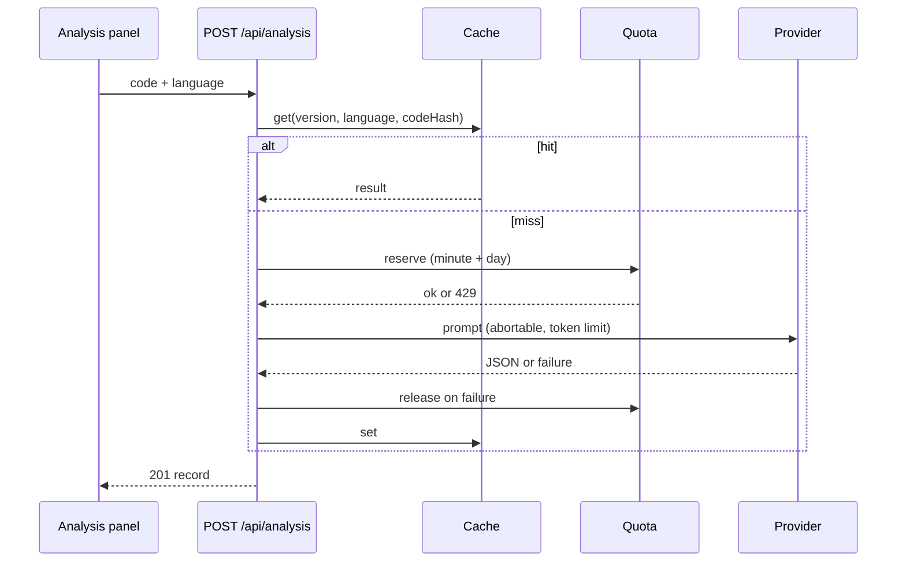

# Phase 7: code analysis

## Endpoints
- `POST /api/analysis` runs an analysis (201 with the record, including `code`, `title`, `isShared`).
- `GET /api/analysis?q=&language=&sort=newest|oldest&limit=&cursor=` returns `{ data, meta: { nextCursor, hasMore } }`.
- `GET /api/analysis/quota` returns `{ minute, day }`, each `{ limit, used, remaining, resetAt }`.
- `GET /api/analysis/:id` returns the record with `code`. `DELETE /api/analysis/:id` returns 204.

## Errors (envelope `{ error: { code, message, retryAfterSeconds?, quota? } }`)
| Code | Status | Meaning | Uses quota? |
| --- | --- | --- | --- |
| QUOTA_EXCEEDED | 429 | per-minute or per-day limit (`quota.scope`), `Retry-After` set | no |
| AI_PROVIDER_UNAVAILABLE | 503 | provider down or all keys exhausted | no (returned) |
| AI_PROVIDER_TIMEOUT | 504 | no answer within `AI_ANALYSIS_TIMEOUT_MS`; request aborted | no (returned) |
| AI_INVALID_OUTPUT | 502 | answer was not valid analysis JSON (retried `AI_MAX_RETRIES` times) | no (returned) |

## Settings (read from the environment; defaults in parentheses)
`AI_ANALYSIS_TIMEOUT_MS` (45000), `AI_ANALYSIS_MAX_OUTPUT_TOKENS` (4096), `AI_TEXT_MAX_OUTPUT_TOKENS` (1024),
`AI_ANALYSIS_PER_MINUTE` (3), `AI_ANALYSIS_PER_DAY` (30). Add them to your own `.env` if you want different values; this phase never edits `.env` files.

## Behaviour
- Cache key: prompt version + language + SHA-256 of the code. A cache hit costs no quota and no provider call.
- Quota: Redis counters (atomic); AiUsage seeds the daily counter and is the fallback when Redis is down (minute counter falls back to process memory). Reservations are released when the AI call fails.
- Explain cache key (`/api/explain`): prompt version + algorithm catalog version + query + detected scope.
- Prompt: user code sits between per-request random markers and is declared untrusted data. Prompt version: `analysis-v2`.

